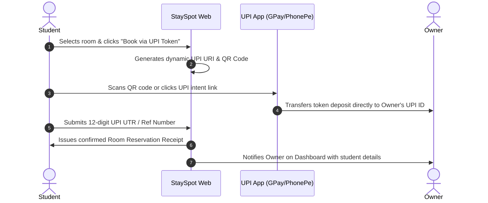

# StaySpot: Student Accommodation Finder 🏠🎓

[](https://react.dev/)
[](https://www.typescriptlang.org/)
[](https://vitejs.dev/)
[](https://tailwindcss.com/)
[](https://www.django-rest-framework.org/)
[](https://www.mongodb.com/)

---

## 🌟 Overview

**StaySpot** connects university students directly with verified PG and hostel owners. It eliminates middleman broker fees, guarantees verified municipality trade certificates, and enables instant room reservations using standard Indian NPCI **UPI Token Payments**.

---

## ✨ Key Features

### 🎓 For Students
- **Smart Campus Discovery**: Search accommodations near college campuses (Bogadi, VVCE, Manasagangothri, Jayalakshmipuram) with live autocomplete.
- **Category & Amenity Filters**: Filter by Boys PGs, Girls PGs, Student Flats, Private Rooms, and Govt Hostels with toggles for Food plans, High-Speed Wi-Fi, and Budget limits.
- **UPI QR Token Reservations**: Reserve a room spot by scanning a dynamic NPCI UPI QR code (supporting GPay, PhonePe, Paytm, and BHIM) or mobile intent link with instant UTR transaction verification.
- **1-Click Travel Integrations**: Direct deep-links for Google Maps navigation and Uber pickup rides directly to the accommodation address.
- **SpotBot AI Assistant**: Floating AI & FAQ assistant providing immediate answers regarding curfew rules, token refunds, and room availability.
- **Direct Messaging**: Chat directly with verified landlords before booking.
- **Persistent Wishlist & Receipts**: Save favorite stays and track verified token booking receipts.

### 🏢 For Property Owners
- **Owner Dashboard**: Real-time metrics tracking active listings, student inquiries, total views, and token receipts.
- **Listing Creator**: Comprehensive accommodation submission with rent, receiving UPI ID, meal configurations, and multi-photo preview.
- **Municipality Trade Certificate Verification**: Upload certificate documents to earn the green "Verified" badge.
- **Direct Inquiry Management**: Review student queries and incoming token receipts without paying broker commission.

---

## 🏗️ Architecture & Technology Stack

```
StaySpot/
├── frontend/                  # Modern React Web Application
│   ├── src/
│   │   ├── components/        # Reusable UI (Navbar, Footer, PropertyCard, BookingModal, Chatbot)
│   │   ├── context/           # React Context (AuthContext, WishlistContext)
│   │   ├── pages/             # Route Pages (Home, Detail, Owner, AddProperty, Chat, FAQ, Login, Register, Profile, Wishlist)
│   │   ├── services/          # Centralized API layer with offline mock fallbacks
│   │   └── types/             # Strong TypeScript definitions
│   ├── package.json
│   └── vite.config.ts
│
├── backend/                   # Django REST Framework Backend
│   ├── backend/               # Project settings & URL routing
│   ├── users/                 # Property & Chat models, serializers, views
│   ├── faq/                   # FAQ question & answer endpoints with voting
│   ├── chatbot_faq/           # FAQ search endpoints for chatbot
│   ├── requirements.txt       # Python dependencies
│   └── manage.py
│
└── README.md
```

---

## 🚀 Quickstart Guide

### 1. Frontend (React + Vite)

```bash
# Navigate to the frontend directory
cd frontend

# Install dependencies
npm install

# Build for production (verifies 0 TypeScript or lint errors)
npm run build

# Start local development server (optional)
npm run dev
```

### 2. Backend (Django REST Framework)

```bash
# Navigate to the backend directory
cd backend

# Create and activate virtual environment
python -m venv venv
# On Windows:
.\venv\Scripts\activate
# On Linux/macOS:
source venv/bin/activate

# Install requirements
pip install -r requirements.txt

# Run migrations and start server
python manage.py migrate
python manage.py runserver
```

---

## 💳 NPCI UPI Payment Flow



---

## 🔒 Security & Verification

- **Environment Isolation**: All credentials and API keys are isolated via `.env.example`.
- **Zero Insecure Embedded Dependencies**: All virtual environments and SDK caches are clean and excluded from version control.
- **Zero Brokers**: All student-to-owner interactions and payments happen directly via NPCI UPI rails.

---

## 👤 Author & Maintainer

* **SyDD2k** ([GitHub: @SyDD2k](https://github.com/SyDD2k))
* Repository: [https://github.com/SyDD2k/stayspot](https://github.com/SyDD2k/stayspot)
